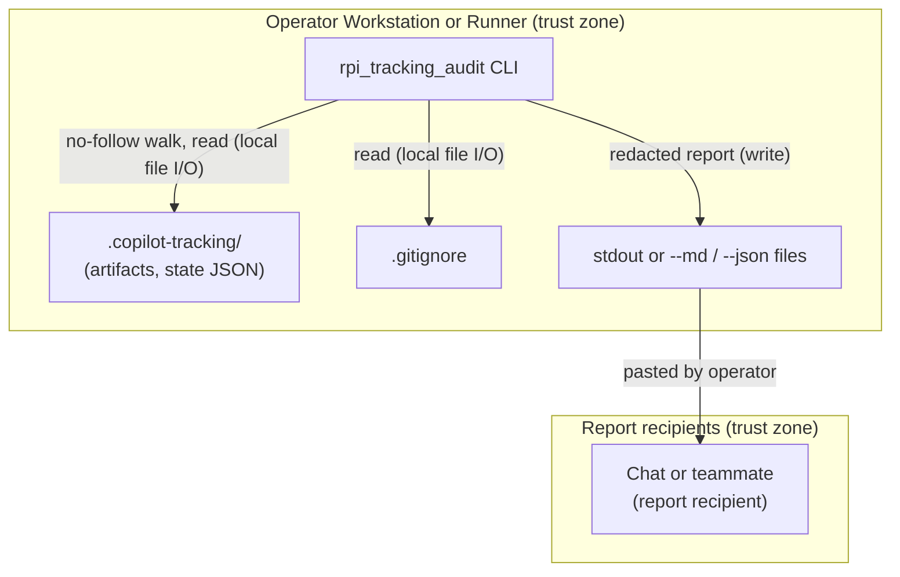

<!-- markdownlint-disable-file -->
# RPI Tracking Audit Skill Security Model

This model covers the runtime of the `rpi-tracking-audit` skill: the standard-library Python package `scripts/rpi_tracking_audit/` (`__main__.py`, `_cli.py`, `_discovery.py`, `_markdown.py`, `_models.py`, `_audit.py`, `_render.py`, `_rules.py`). It decomposes the runtime into three trust buckets: B1 tracking-file parsing, B2 credential-shaped content and report disclosure, and B3 filesystem traversal and report writes. Each bucket enumerates all six STRIDE categories with the in-code mitigations that address them.

> **See also: repo-wide STRIDE model.** This skill participates in the repository-wide threat model recorded in [docs/security/security-model.md](../../../../docs/security/security-model.md) and is registered in its Skill Security Models section.

## Executive Summary

The skill reads the RPI tracking artifacts and RPI Agent session state files under a workspace's `.copilot-tracking/` folder and writes a Markdown or JSON report to stdout or to operator-named files. Tracking files can carry text copied from external research and, by accident, credentials, and reports are meant to be pasted into chats and handed to teammates. The highest-risk behavior is therefore disclosure of a credential through a report; the runtime redacts credential-shaped values before parsing any field, but detection is pattern-based. There is no network egress, no subprocess, and no credential use.

### Security Posture Overview

| Dimension          | Value                                                                                                                                          |
|--------------------|------------------------------------------------------------------------------------------------------------------------------------------------|
| Runtime surface    | Local Python CLI; regex parse of tracking Markdown; `json.loads` of state files; no-follow directory walk; stdout or report files              |
| Trust buckets      | B1 tracking-file parsing, B2 credential-shaped content and report disclosure, B3 filesystem traversal and report writes                        |
| Credentials        | None used; credential-shaped values found in tracking files are redacted from every output and reported by file and line                       |
| Network egress     | None                                                                                                                                           |
| Open residual gaps | 4 (InfoDisc-Med pattern-based secret detection; Tampering-Low quoted artifact text; DoS-Low unbounded Markdown reads; Tampering-Low overwrite) |

## Contents

* [System Description](#system-description)
* [Trust Boundaries](#trust-boundaries)
* [Assets](#assets)
* [Adversaries](#adversaries)
* [Bucket B1: Tracking-file parsing](#bucket-b1-tracking-file-parsing)
* [Bucket B2: Credential-shaped content and report disclosure](#bucket-b2-credential-shaped-content-and-report-disclosure)
* [Bucket B3: Filesystem traversal and report writes](#bucket-b3-filesystem-traversal-and-report-writes)
* [Enterprise Readiness Gaps](#enterprise-readiness-gaps)
* [References](#references)

## System Description

### Components

1. `__main__.py` and `_cli.py`: parse arguments, validate them, run the audit, and write the report to stdout or to the `--md` and `--json` paths.
2. `_discovery.py`: locate `.copilot-tracking/` at the workspace root, walk it without following symbolic links, classify files by path, and load JSON files shaped like RPI Agent state.
3. `_markdown.py`: split Markdown into headings, markers, sections, bullets, and tables with anchored regular expressions, and redact credential-shaped values.
4. `_models.py` and `_audit.py`: derive per-artifact models, evaluate the rules, and derive task state and next actions.
5. `_render.py`: render the Markdown report and the JSON object, applying redaction to every string.
6. `_rules.py`: the rule table, vocabularies, and patterns, including the credential patterns.

### Data Flow



## Trust Boundaries

### Boundary Diagram

```text
┌──────────────────────────────────────────────────────────────────┐
│ TRUST BOUNDARY: Operator Workstation / Runner                    │
│  ┌──────────────────┐   ┌────────────────────┐   ┌────────────┐  │
│  │ rpi_tracking_    │──▶│ .copilot-tracking/ │   │ stdout or  │  │
│  │ audit CLI        │   │ (untrusted content)│   │ report     │  │
│  │                  │──────────────────────────▶│ files      │  │
│  └──────────────────┘   └────────────────────┘   └─────┬──────┘  │
└────────────────────────────────────────────────────────┼─────────┘
                                                         │ operator pastes
                              ┌──────────────────────────▼─────────┐
                              │ TRUST BOUNDARY: Report recipients  │
                              │ (chat session, teammate, ticket)   │
                              └────────────────────────────────────┘
```

### Boundary Descriptions

| Boundary                       | Assets Protected                                     | Controls Enforced                                                                                                       |
|--------------------------------|------------------------------------------------------|-------------------------------------------------------------------------------------------------------------------------|
| Operator workstation or runner | Tracking files, files outside the workspace, process | Read-only access to tracking files; no symbolic links followed; JSON parsed with `json.loads`; no subprocess or network |
| Report recipients              | Credentials recorded in tracking files               | Redaction before parsing and on every rendered string; `--task` drops other tasks' state files and findings             |

## Assets

| Id | Asset                         | Lifetime                 | Notes                                                                                                                          |
|----|-------------------------------|--------------------------|--------------------------------------------------------------------------------------------------------------------------------|
| A1 | Tracking artifacts            | Read-only during the run | Markdown written by RPI skills; may quote web research, tool output, or pasted text                                            |
| A2 | RPI Agent session state files | Read-only during the run | JSON with decisions, blockers, and paths; may hold credential-like values by mistake                                           |
| A3 | Credentials in A1 or A2       | Read-only during the run | Never used; matched values are redacted and reported only by file and line                                                     |
| A4 | Report                        | Operator-controlled      | Markdown or JSON on stdout or at `--md` and `--json` paths; designed to be shared                                              |
| A5 | Files outside the workspace   | Not accessed             | Paths named in artifacts or state are checked only when they stay inside the workspace without passing through a symbolic link |

## Adversaries

| Id    | Adversary                                                      | In-scope mitigations                                                                                                    |
|-------|----------------------------------------------------------------|-------------------------------------------------------------------------------------------------------------------------|
| ADV-a | Author of untrusted text copied into a tracking artifact       | Text is parsed as data with anchored regular expressions; quoted cells are truncated and pipe-escaped; no evaluation    |
| ADV-b | Contributor who planted a symbolic link in the tracking folder | `os.walk` skips linked directories and files; a linked tracking root is not read; `--file` refuses any linked component |
| ADV-c | Report recipient who should not see a credential in the folder | Pattern redaction before parsing and on output; key-aware JSON redaction; `--task` filtering of other tasks' state      |

## Bucket B1: Tracking-file parsing

### Spoofing

* Not applicable. The audit authenticates no party and trusts no file's claimed origin; every statement in the report is tied to the file path it was read from.

### Tampering

* Artifact text is never executed or evaluated. Markdown is split with anchored regular expressions and JSON with `json.loads`; values flow only into string comparisons and report cells.
* Quoted artifact text in reports passes through `short()` (whitespace collapsed, redacted, truncated) and `md_escape()` (pipes and newlines escaped), so a crafted value cannot add table rows or columns (G-TAM-1 records the residual).

### Repudiation

* Not applicable. The audit is read-only and records no actions; each finding names the rule, the artifact path, and the evidence text, and the report header records the reference date and tool version.

### Information Disclosure

* See Bucket B2. Parsing reads only files under the workspace's `.copilot-tracking/` folder, the root `.gitignore`, and, in a single-file run, the one file `--file` names.

### Denial of Service

* Headings, bullets, vocabulary values, and links are parsed with bounded or anchored patterns, and lines over 2,000 characters are never parsed as headings or line references, so parsing time grows linearly with input size. Heading ranges are computed once per file, findings are deduplicated by key, and named pipes and other special files in the tracking folder are skipped without being opened.
* State files over 5 MB are not parsed, and deeply nested JSON is treated as not being state. Markdown artifacts are read whole into memory with no size cap; a very large file in the operator's own folder slows the local process (G-DOS-1).

### Elevation of Privilege

* No subprocess, `eval`, `exec`, `pickle`, or dynamic import runs on file content. The process runs with the operator's own rights.

### Risk Rating

| Threat                                                | Likelihood | Impact | Residual Risk | Status                                                     |
|-------------------------------------------------------|------------|--------|---------------|------------------------------------------------------------|
| Crafted artifact text breaks the report structure     | Low        | Low    | Low           | Mitigated (`md_escape`, `short`)                           |
| Instructions embedded in artifact text reach an agent | Med        | Low    | Low           | Partially Mitigated (SKILL.md guardrail) (G-TAM-1)         |
| Oversized artifact slows the local process            | Low        | Low    | Low           | Accepted (operator's own folder; linear parsing) (G-DOS-1) |

## Bucket B2: Credential-shaped content and report disclosure

### Spoofing

* Not applicable. Redaction does not depend on who wrote a file.

### Tampering

* Redaction preserves line counts, so the file and line HY1 reports stay accurate after private key blocks are replaced.

### Repudiation

* Not applicable. HY1 findings name the file, the pattern label, and the line, without the value.

### Information Disclosure

* `Artifact` keeps the raw text only for the HY1 scan and builds every parsed field from `redact(raw_text)`.
* State files are passed through `redact_obj()` after `json.loads`: keys are redacted like any string, and a string of eight or more characters under a key named like a credential (`accessToken`, `client_secret`, `dbPassword`, `api_key`, `connection_string`) is replaced whole. The JSON report carries only the State contract's fields, so other keys in a state file are not reported.
* The Markdown report is redacted again before it is written, and the JSON object is redacted recursively in `to_json()`.
* `--task` removes other tasks' state files and their findings, so a handover report carries one task's decisions and blockers.
* Detection covers AWS, GitHub, and Slack tokens, private key blocks, JSON web tokens, bearer tokens, Azure storage account keys, shared access signatures, connection-string passwords, and token or password assignments; a credential in another format, such as a passphrase without digits, passes through to the report (G-INF-1).

### Denial of Service

* Not applicable. Redaction runs once per file and once per rendered report.

### Elevation of Privilege

* Not applicable. Redacted values are never used.

### Risk Rating

| Threat                                                 | Likelihood | Impact | Residual Risk | Status                                          |
|--------------------------------------------------------|------------|--------|---------------|-------------------------------------------------|
| Known-format credential copied into a shared report    | Low        | High   | Low           | Mitigated (redaction before parsing and output) |
| Unknown-format credential copied into a shared report  | Low        | High   | Med           | Accepted (documented limitation) (G-INF-1)      |
| Other tasks' state disclosed in a single-task handover | Low        | Med    | Low           | Mitigated (`--task` filtering)                  |

## Bucket B3: Filesystem traversal and report writes

### Spoofing

* A symbolic link cannot stand in for a tracking file or folder: the walk skips linked entries and lists them in the report, a linked `.copilot-tracking` root is reported and not read, and `--file` refuses a path with a linked component below the workspace root.

### Tampering

* Tracking files, `.gitignore`, and state files are opened read-only; the audit writes nothing except the report files the operator names.
* `--md` and `--json` overwrite an existing file at the given path without confirmation (G-TAM-2).

### Repudiation

* Not applicable. The run writes no log; the report header records the workspace, reference date, and tool version.

### Information Disclosure

* Reads are limited to the root `.copilot-tracking/` folder, the root `.gitignore`, and, in a single-file run, the one file `--file` names, which must carry an RPI artifact suffix; nested tracking folders are listed by path and not read. Existence checks on artifact-named paths never leave the workspace.
* The report includes the absolute workspace path and workspace-relative artifact paths, which the operator shares by choice.

### Denial of Service

* The search for nested tracking folders stops at six levels and skips `node_modules`, virtual environments, and build folders; the report says when the depth limit was reached.

### Elevation of Privilege

* No path from file content is opened, written, or executed. A path named in an artifact or a state file is tested only when it resolves inside the workspace without a symbolic link component, and an over-long or malformed path counts as missing.

### Risk Rating

| Threat                                                 | Likelihood | Impact | Residual Risk | Status                                     |
|--------------------------------------------------------|------------|--------|---------------|--------------------------------------------|
| Planted symbolic link exposes files outside the folder | Low        | Med    | Low           | Mitigated (no-follow walk and `--file`)    |
| Report path overwrites an existing operator file       | Low        | Low    | Low           | Accepted (operator-named path) (G-TAM-2)   |
| Deep repository slows the nested-folder search         | Low        | Low    | Low           | Mitigated (six-level cap, skipped folders) |

## Enterprise Readiness Gaps

The following are known limitations recorded so operators can make informed deployment decisions. Severity ratings are the project's own assessment and are not equivalent to a CVSS score.

| Id      | Gap                                                                                                                                  | Severity      | Status                                                                                                       |
|---------|--------------------------------------------------------------------------------------------------------------------------------------|---------------|--------------------------------------------------------------------------------------------------------------|
| G-INF-1 | Credential detection is pattern-based; a credential in a format outside the fixed patterns is not redacted from reports.             | InfoDisc-Med  | Accepted: SKILL.md and the rule catalog state that a clean HY1 result is not an assurance.                   |
| G-TAM-1 | Reports quote artifact text (titles, blockers, decisions); instructions embedded in that text reach the agent that reads the report. | Tampering-Low | Partially mitigated: quoted text is truncated and escaped, and SKILL.md tells the agent to treat it as data. |
| G-DOS-1 | Markdown artifacts are read whole with no size cap.                                                                                  | DoS-Low       | Accepted: the input is the operator's own folder, the process is local, and parsing is linear.               |
| G-TAM-2 | `--md` and `--json` overwrite an existing file at the given path.                                                                    | Tampering-Low | Accepted: the operator names the path.                                                                       |

For an active issue tracker entry covering these gaps, see the [hve-core issues list](https://github.com/microsoft/hve-core/issues).

## References

* [Repository-wide security model](../../../../docs/security/security-model.md)
* Skill security model conventions: `skill-security-model.instructions.md`.
* [STRIDE Threat Model](https://learn.microsoft.com/azure/security/develop/threat-modeling-tool-threats)
* [OWASP Secrets Management Cheat Sheet](https://cheatsheetseries.owasp.org/cheatsheets/Secrets_Management_Cheat_Sheet.html)

🤖 Crafted with precision by ✨Copilot following brilliant human instruction, then carefully refined by our team of discerning human reviewers.
